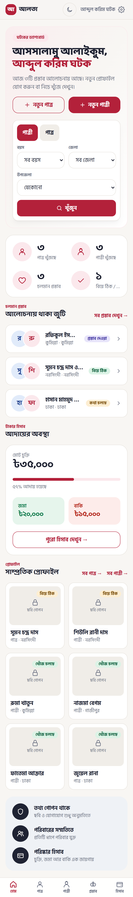
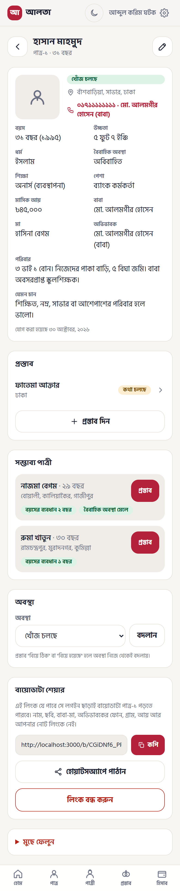
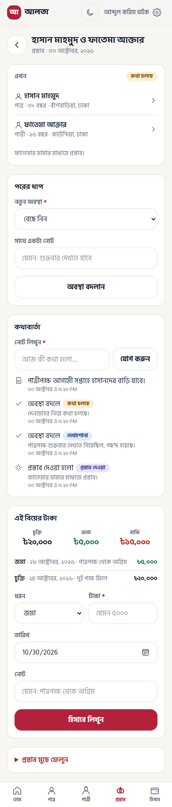
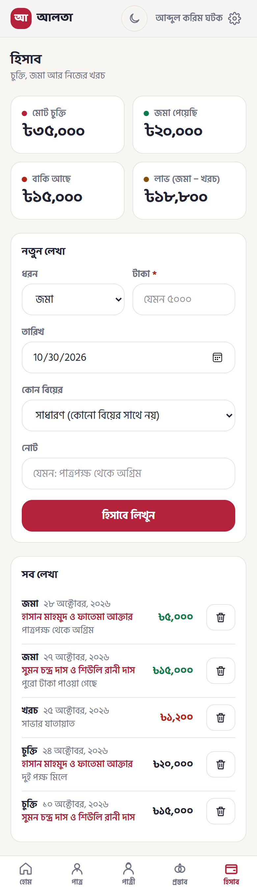
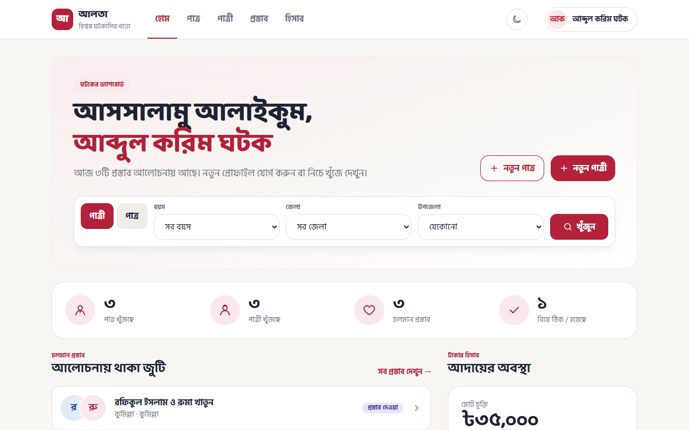
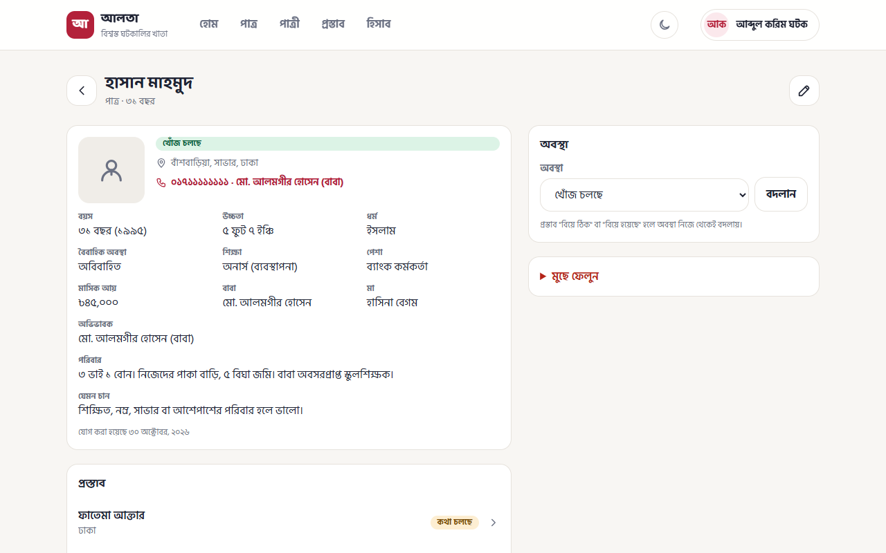
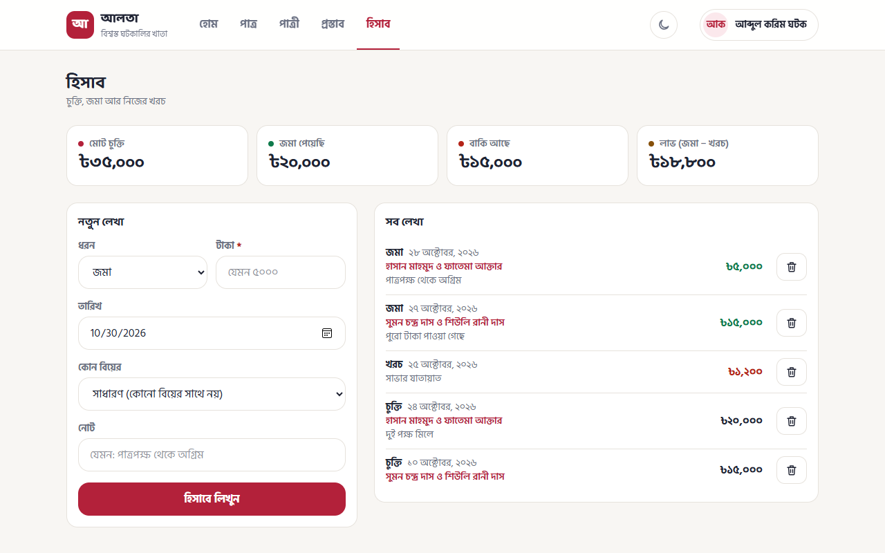

# আলতা (Alta)

গ্রামের ঘটকের ডিজিটাল খাতা। A matchmaking ledger for village ghotoks: the people they are finding matches for,
every proposal and how far the talks have gone, and the money agreed, received and spent.

Each ghotok signs in with a phone number and password and sees only their own records. Several ghotoks can share
one deployment. An **admin** role sees every ghotok's counts and money totals at `/admin` (never their people); the first
admins are named in `ADMIN_PHONES`, and an admin can make others admins from that page. One codebase serves both a **website** (a top-bar layout on a computer) and a **phone app**
(installed from the browser onto the home screen); see [Web and mobile](#web-and-mobile).

## Screens

| Route | What it does |
|---|---|
| `/login`, `/register` | Sign in, or open a new account; on a computer the brand panel sits beside the form |
| `/` | Dashboard: greeting, a search bar into the lists, how many patro/patri are looking, live proposals, money at a glance, recent people |
| `/patro`, `/patri` | Biodata cards of grooms and brides, with a filter column: status, age, place, religion, marital status, education, profession, height, income |
| `/profiles/new?kind=patro` | Add a person (name, age, education, address, guardian, family, expectations) |
| `/profiles/[id]` | One person: details, their proposals, suggested matches, status, public share link, delete |
| `/b/[token]` | Public biodata a ghotok chose to share: biodata number, age, height, religion, marital status, education, profession, upazila and district, family, expectations, and the ghotok's number; no name, photo, parents, guardian phone, village, income or notes. Switched on and off from the person's page |
| `/proposals` | Every proposal, filtered by stage |
| `/proposals/new` | Pair one patro with one patri |
| `/proposals/[id]` | Stage changes with a timeline, notes, and the money for this match |
| `/hisab` | Ledger: agreed fees (চুক্তি), payments received (জমা), own expenses (খরচ) |
| `/settings` | Account, install on the phone, light or dark theme, sign out |
| `/admin` | Admin only: ghotoks, people, proposals and marriages in total, money across all ledgers, every ghotok with their counts, make or unmake admins |
| `/offline` | What the installed app shows when there is no internet |

Proposal stages: প্রস্তাব দেওয়া → দেখাশোনা → কথা চলছে → বিয়ে ঠিক → বিয়ে হয়েছে, or বাদ at any point.
When a proposal reaches বিয়ে ঠিক both people become "engaged"; after বিয়ে হয়েছে both become "married".

Minimum ages are enforced when a person is added: patro 21, patri 18.

## Web and mobile

The same pages render two layouts, chosen by screen width (Tailwind's `lg` breakpoint, 1024px):

- **Phone and tablet**: one column, a slim top bar and a tab bar along the bottom with the five everyday screens.
  Open the site in Chrome on Android or Safari on iPhone and go to **সেটিংস → ফোনে app হিসেবে রাখুন**: Chrome shows an
  install button, Safari gets the "Add to Home Screen" steps. Installed, আলতা opens full-screen with its own icon
  and splash colour, long-pressing the icon offers নতুন পাত্র / নতুন পাত্রী / হিসাব shortcuts, and losing the
  connection shows a Bangla "ইন্টারনেট নেই" page instead of a browser error.
- **Computer**: a bar across the top with the same screens and the signed-in name (which opens settings); a wider page; and two
  columns where there is room (dashboard, person, proposal, ledger). Forms stay one narrow column. Edge and Chrome
  offer to install it as a desktop app from the address bar too.

Colours follow the phone's light or dark setting. **সেটিংস → থিম** fixes one on that device (kept in the browser, not on
the server), and the sun/moon button in either bar flips it in one tap.

The phone layout's DOM order is kept on every screen; the wide layout only regroups cards into columns.

How the app side works: `app/manifest.ts` is the web app manifest (`/manifest.webmanifest`), the icons in `public/`
come from `npm run icons`, and `public/sw.js` is the service worker. The worker is registered only in production
builds (`components/pwa.tsx`); it caches hashed build assets and the offline page, and never caches a ghotok's
pages, which always come from the server. The proxy lets the manifest, the worker and `/offline` through without a
session. Everything else needs a connection: there is no offline editing.

## Stack

Next.js 16 (App Router, Server Actions), TypeScript, Tailwind CSS 4, Drizzle ORM on PostgreSQL (Supabase),
Better Auth (phone + password), Zod. Bangla UI with self-hosted Hind Siliguri and Baloo Da 2 fonts. Installable as a
progressive web app (manifest, home-screen icons, offline page).

## Screenshots

Captures of every screen live in [docs/screens](docs/screens/) (`npm run screenshots` refreshes them against a
running dev server): phone-sized, full-page captures numbered `01-…`, and laptop-width captures named `web-…`.

| Home | Person | Proposal | Ledger |
|---|---|---|---|
|  |  |  |  |

| Web: home | Web: person | Web: ledger |
|---|---|---|
|  |  |  |

## Quick start (no database to set up)

```bash
npm install
npm run dev
```

Without a `DATABASE_URL`, the app runs on an embedded Postgres (PGlite) stored in `./.data/alta-dev`; `npm run dev`
applies the migrations to it first. Open http://localhost:3000 and press **ডেমো ডেটা তৈরি করে ঢুকুন** on the login
page to get a demo ghotok (`01700000000` / `alta1234`) with sample people, proposals and ledger entries, a second
ghotok, and a demo admin (`01700000009` / `alta1234`) for `/admin`. Delete the
`.data` folder to start over. After adding a migration, `node scripts/dev-db.mjs` applies it while `npm run dev` keeps running. `ALTA_DEV_DB_DIR` in `.env.local` moves the database to another folder: create it first with `ALTA_DEV_DB_DIR=./.data/alta-fresh node scripts/dev-db.mjs`, then set the variable, and the running server switches over. This mode is for local work only; production refuses to start without a database.

To try the installed-app behaviour locally, use a production build (`npm run build && npm start`): the service
worker is not registered by the dev server. Installing needs HTTPS, except on `localhost`.

## Production setup (Supabase)

1. Create a Supabase project. Copy the **Shared Pooler** (transaction mode) connection string and the **Direct**
   connection string from Project → Connect.
2. Copy `.env.example` to `.env.local` and fill in `DATABASE_URL` (pooler), `DIRECT_URL` (direct) and
   `BETTER_AUTH_SECRET` (`openssl rand -base64 32`).
3. Migrate and run:

```bash
npm run db:migrate
npm run dev
```

4. Open http://localhost:3000, create the first account at `/register`, and start adding people.

## Scripts

| Script | Purpose |
|---|---|
| `npm run dev` | Development server |
| `npm run build` / `npm start` | Production build and server |
| `npm run typecheck` | Generate route types and run the TypeScript compiler |
| `npm run lint` | ESLint |
| `npm test` | Service and manifest tests on an in-process Postgres (PGlite) with the real migrations; no database needed |
| `npm run db:generate` | Write a new SQL migration from `lib/db/schema.ts` into `drizzle/` |
| `npm run db:migrate` | Apply migrations to `DIRECT_URL` |
| `npm run screenshots` | Capture every screen (phone and web) into `docs/screens/` using the installed Edge or Chrome (dev server must be running) |
| `npm run icons` | Redraw the home-screen icons in `public/` (only after changing the mark or brand colour) |

## Layout

```
app/            routes; (auth) = login and register, (app) = everything behind sign-in, offline = no-internet page
app/manifest.ts web app manifest for installing on a phone
components/     UI building blocks and client-side forms; nav.tsx = tab bar + top bar, pwa.tsx = worker + install card
lib/db/         Drizzle connection and schema
lib/auth/       Better Auth setup, session helpers, login actions
lib/services/   all reads and writes, scoped to one ghotok, throwing AppError on expected failures
lib/actions/    server actions: validate the form, call a service, redirect or return a Bangla message
lib/bn.ts       Bangla numerals, money and status labels
public/         home-screen icons and sw.js (the service worker)
drizzle/        generated SQL migrations
scripts/        dev-db.mjs (migrate the embedded dev database), screenshots.mjs, icons.mjs
tests/          Vitest tests (tests/testdb.ts boots PGlite and applies drizzle/)
docs/screens/   screenshots of every screen
```

## Next steps

- Photo upload to Supabase Storage (today a photo is a pasted link).
- Share a printable biodata (PDF) of one person with a family.
- Reminders: "call the patri's family on Friday".
- Rate-limit sign-in attempts per phone number.
- A store listing (Android/iOS shell around the same site) if ghotoks look for it in the Play Store.
